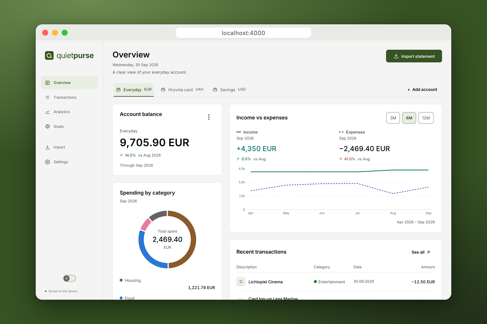
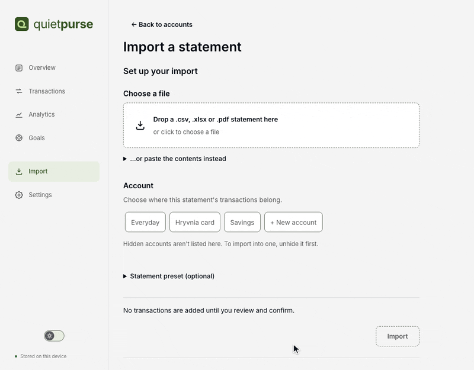
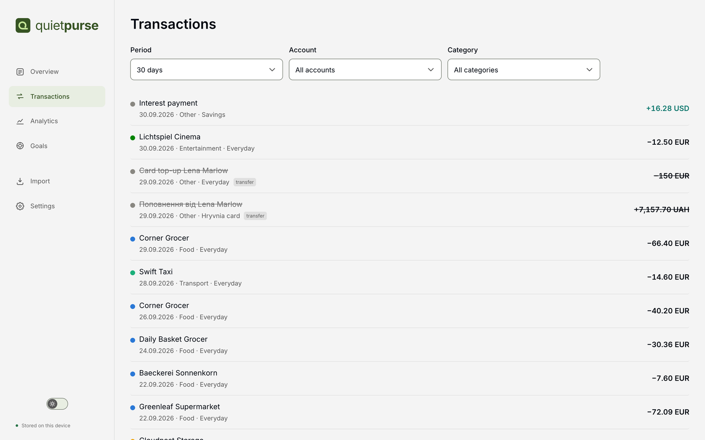
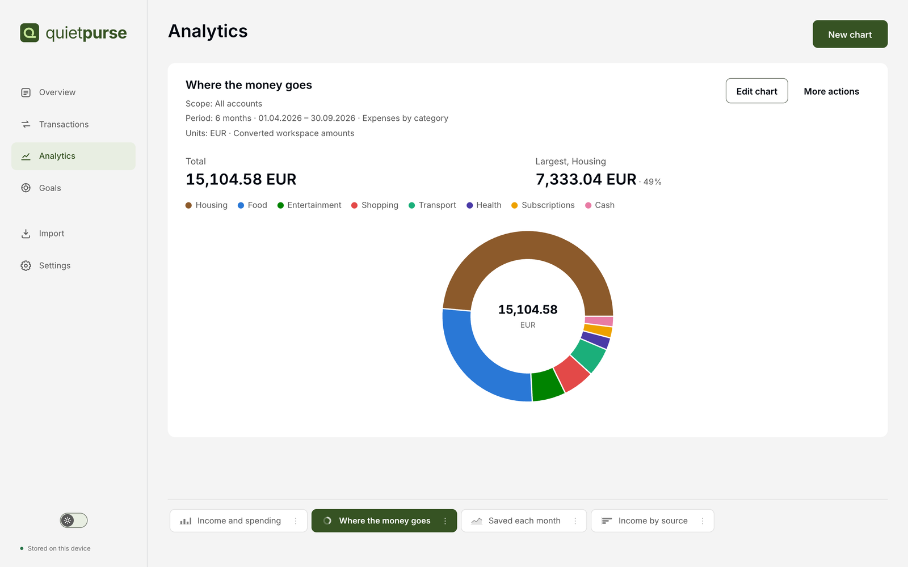
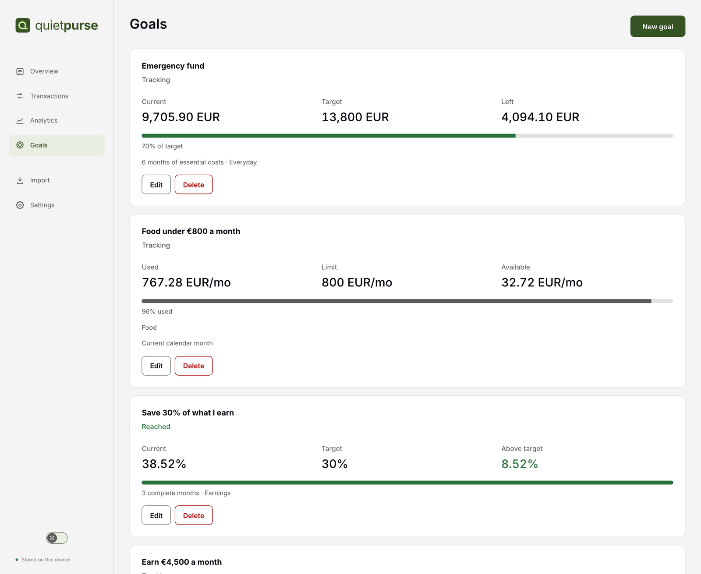
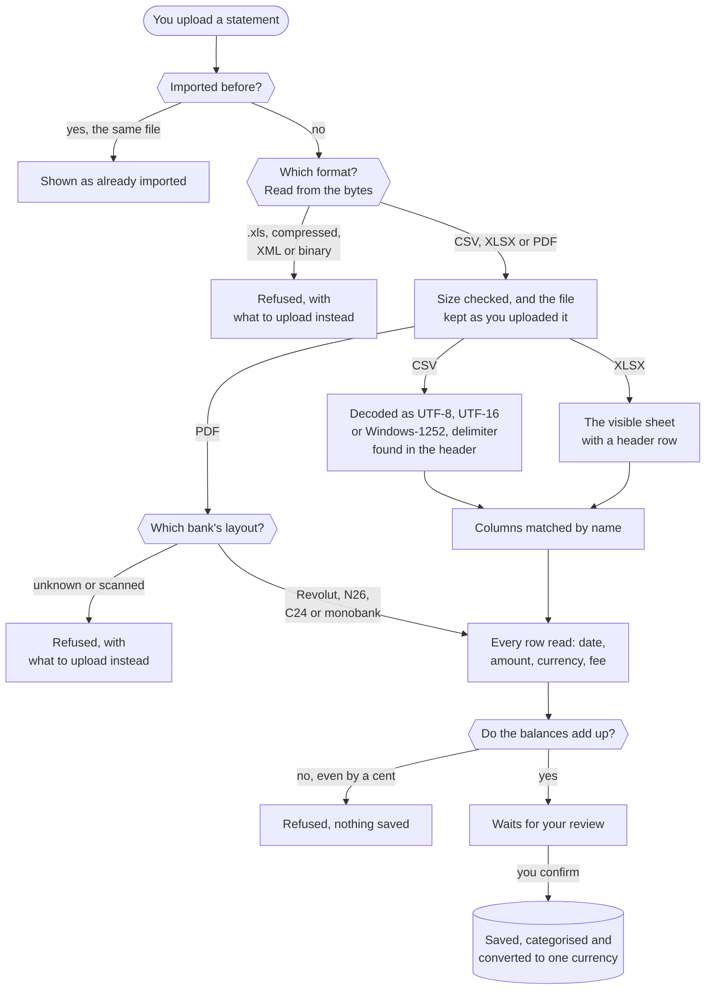

<p align="center">
  <picture>
    <source media="(prefers-color-scheme: dark)" srcset="media/logo-dark.svg">
    
  </picture>
</p>

<p align="center">
  A personal finance tracker that runs on your own machine.<br>
  Upload your bank statements and see where your money goes, in one currency.
</p>

<p align="center">
  <a href="https://github.com/VanishJr/quietpurse/actions/workflows/ci.yml"></a>
  
  
</p>

<p align="center">
  <picture>
    <source media="(prefers-color-scheme: dark)" srcset="media/overview-dark.png">
    
  </picture>
</p>

> [!NOTE]
> **Hi there!** I made Quietpurse partly as an experiment in building software with coding agents,
> and partly because I needed it. I looked for apps and services to keep track of my finances, but
> most of them were paid, or could not do what I needed.
>
> Feedback and critique are very welcome!

---

## Why

Banking apps show one account in one currency. Once your accounts are spread across banks and
countries, none of them answers the plain questions: what do I actually spend, and how much do I
need to earn to support myself?

Quietpurse keeps that answer current. Importing is one button, categories come from rules rather
than memory, and every figure is recomputed when you open the app. Two things set it apart:

- **Each amount is converted at the rate on its own date**, so one month can be compared with
  another.
- **Income is split into your own and external.** Family support or a stipend is not earnings and
  does not count toward self-sufficiency.

## Installation

Needs Node.js 22.13 or newer, and nothing else.

```bash
git clone https://github.com/VanishJr/quietpurse.git && cd quietpurse
npm run setup
npm start
```

Then open http://localhost:4000. Everything is kept in `~/Quietpurse`: the database and the
statements you uploaded, as plain files you can copy, back up or delete. The only thing the app
fetches from the internet is exchange rates.

## Features

- **One upload button.** CSV, XLSX or PDF, and the right parser is picked for you. Most banks'
  CSV and XLSX exports are read by their column names. PDF statements are read so far from Revolut
  (in Russian), N26 and C24 (in German) and monobank; more banks are on the way.

  <picture>
    <source media="(prefers-color-scheme: dark)" srcset="media/import-dark.gif">
    
  </picture>

- **Transactions** are categorised by merchant code and description, and a rule moves every
  transaction like this one at once. Transfers between your own accounts, refunds and recurring
  payments are found for you.

  <details>
  <summary><b>The Transactions screen</b></summary>

  <picture>
    <source media="(prefers-color-scheme: dark)" srcset="media/transactions-dark.png">
    
  </picture>
  </details>

- **Analytics:** charts you build yourself. Follow income, spending and net over time, or see
  where your money comes from and where it goes, by category or by income source, over ranges from
  three months to five years.

  <details>
  <summary><b>The Analytics screen</b></summary>

  <picture>
    <source media="(prefers-color-scheme: dark)" srcset="media/analytics-dark.png">
    
  </picture>
  </details>

- **Goals:** financial independence, an emergency fund, savings, paying off a debt, monthly
  income, savings rate and category limits, each computed from your own data.

  <details>
  <summary><b>The Goals screen</b></summary>

  <picture>
    <source media="(prefers-color-scheme: dark)" srcset="media/goals-dark.png">
    
  </picture>
  </details>

- **Export** every transaction, account and setting to one readable JSON file, from Settings. The
  statements you uploaded are not in it: they stay as files in `~/Quietpurse/statements`. The app
  has no button to restore an export.

- **A dark mode**, and a light one.

## How a statement is read

Every upload takes the same path, whatever the bank or the format, and nothing reaches your data
until you have looked at what was read.



The format comes from the file's content, so a statement the bank or the browser named oddly still
reads, and a signed PDF wrapped in an envelope is found inside it. Where a statement prints its
balances, the rows have to add up to them exactly: a statement read even one cent wrong is refused,
not imported with a gap. [ARCHITECTURE.md](ARCHITECTURE.md) has the same path with the module behind
each step.

## Configuration

Nothing is required. To change a setting, put it in `backend/.env` (copy `backend/.env.example`,
which lists the rest) or in the environment of `npm start`; a `.env` at the repository root is not
read. The settings worth knowing:

| Variable | Default | What it does |
|---|---|---|
| `PORT` | `4000` | the port the app is served on |
| `QUIETPURSE_HOME` | `~/Quietpurse` | the folder everything is kept in |
| `QUIETPURSE_HOST` | `127.0.0.1` | `0.0.0.0` opens the app to a phone on the same Wi-Fi. There is no sign-in, so anyone who can reach the port can read and change your data |

## Development

The backend is Express 5 and TypeScript over Postgres running inside the process (PGlite); the
client is React 19, Vite and Recharts.

```bash
cd backend && npm run dev     # the API on http://localhost:4000
cd web && npm run dev         # the client on http://localhost:5173, proxying /api
npm test                      # both packages
npm run typecheck             # both packages
```

Read more:

- [ARCHITECTURE.md](ARCHITECTURE.md): the module map, and the path one statement takes through it
- [SECURITY.md](SECURITY.md): the threat model
- [CONTRIBUTING.md](CONTRIBUTING.md): how to propose a change
- [AGENTS.md](AGENTS.md): the rules for changing the code, for people and AI agents alike

## License

[MIT](LICENSE)
